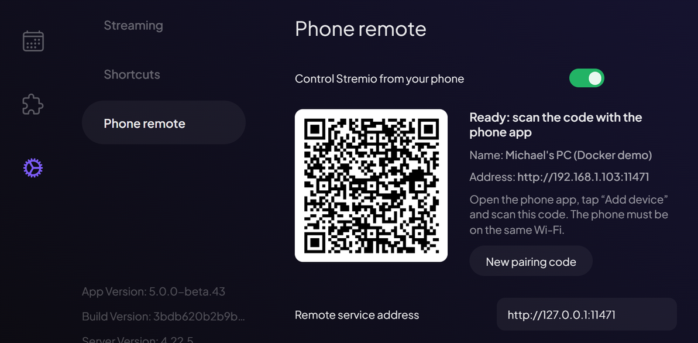
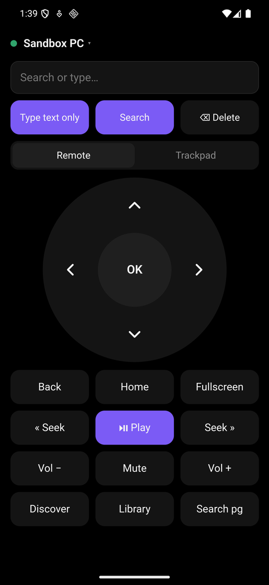
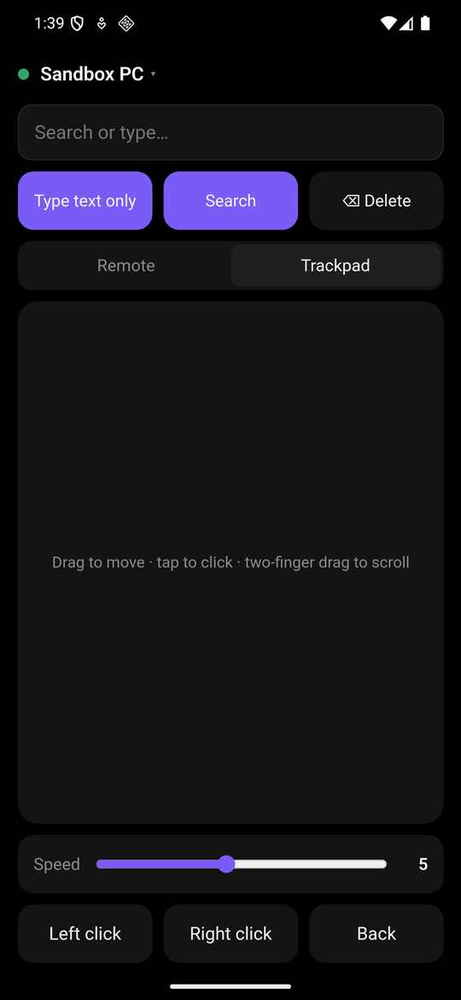
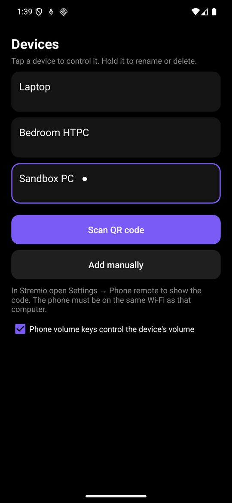
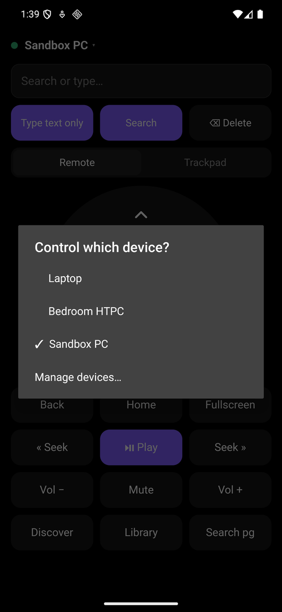

# Phone remote for Stremio (unofficial)

An Android remote that pairs with a Stremio install by scanning a QR code.

The app needs a small change to Stremio itself, which adds the QR code and the
remote channel. That change lives on two forks:

- [MichaelRoe-Software/stremio-web, branch `phone-remote`](https://github.com/MichaelRoe-Software/stremio-web/tree/phone-remote)
  adds Settings → Phone remote and the in-page handler for remote commands.
- [MichaelRoe-Software/stremio-service, branch `phone-remote`](https://github.com/MichaelRoe-Software/stremio-service/tree/phone-remote)
  adds the relay (`remote-relay/`), a small Rust server on port 11471.

> **Not affiliated with Stremio.** "Stremio" is a registered trademark of Smart
> Code OOD. This is a proposal shared with the Stremio team. The name in the app
> ("Stremio App") is a working title. No builds are published, and the app won't
> be published under the Stremio name without their permission.

## Screenshots

In Stremio, **Settings → Phone remote** shows the pairing code:



The app:

| Remote | Trackpad | Devices | Switching device |
|---|---|---|---|
|  |  |  |  |

## How it fits together

```
 phone (this app)  ──HTTP + X-Token──▶  relay :11471  ──WebSocket──▶  Stremio web UI
   d-pad, search,                       (stremio-service,             runs the command in-page:
   trackpad, volume                      or standalone)                focus ring, router, player
```

| Piece | Where | What it does |
|---|---|---|
| Settings → **Phone remote** | stremio-web fork | Shows a QR code (`{"name","url","token"}`), the connection status and a *New pairing code* button. |
| In-page remote service | stremio-web `src/services/PhoneRemote/` | Connects to the relay and runs commands in the page: d-pad navigation with a focus ring, OK and Back, page shortcuts, search, typing into the focused text box, a virtual trackpad cursor, and the player's own play/pause, seek and volume. |
| Relay | stremio-service `remote-relay/` | Rust (axum) server on port **11471**. stremio-service starts it next to server.js; turn it off with `--no-phone-remote`. It also builds as a standalone binary or Docker image. It keeps a random token for each install in the user config folder. |
| This app | here | Kotlin. Its only dependencies are AndroidX core and ZXing for the QR scanner. |

**Security model:**
- The token and the page channel (`/pairing`, `/page`) are only served to loopback clients from an allowed web UI origin. Allowed: web.stremio.com, localhost builds, and anything in `RELAY_ALLOWED_ORIGINS`.
- Phone commands need the token.
- *New pairing code* rotates the token, so paired phones must scan again.
- Nothing leaves the local network; there's no cloud service.

## Using it

1. On the computer, open Stremio → **Settings → Phone remote**.
2. With the phone on the same Wi-Fi, open the app and tap **Scan QR code**. Allow the camera.
3. Name the device (for example "Living room") and save.

The app remembers every paired device and reconnects to the last one on launch.
- **Switch devices:** tap the device name at the top.
- **Rename or delete:** in *Devices*, hold a device.
- **Pairing link:** `stremioapp://pair?data=<url-encoded JSON>` does the same as scanning.

**Controls:**
- **Navigation:** the d-pad moves the focus ring and OK clicks. Back closes a popup or goes back.
- **Page shortcuts:** Home, Discover, Library and Search.
- **Text:** the search box searches. *Type text only* types into the focused text box.
- **Trackpad:** moves an on-screen cursor. Tap to click, use two fingers to scroll.
- **While a video plays:** the d-pad works like a TV remote. Left/right seek, up/down change volume, OK plays or pauses.
- **Volume:** the volume buttons and the phone's volume keys change Stremio's player volume.
- **Fullscreen:** works in the desktop app. In a browser it can't work without a real click on the page, so the app tells the user to click fullscreen or press F11.

## Try it with Docker

The stremio-web fork's `phone-remote-demo/` runs the official `stremio/server`
image unchanged, plus the web UI fork and the relay:

```bash
cd stremio-web/phone-remote-demo
```

```bash
cp .env.example .env
```

Set `RELAY_PUBLIC_URL` in `.env` to the computer's LAN IP, then:

```bash
docker compose up -d --build
```

Open http://localhost:8090/#/settings → Phone remote and scan the code.

In the official Windows desktop app (5.x) you can test the same web UI with
`stremio-shell-ng.exe --webui-url=http://<host>:8090/`, with the relay running
alongside.

## Building

JDK 17 and the Android SDK:

```bash
./gradlew assembleDebug
```

The APK is `app/build/outputs/apk/debug/app-debug.apk`.

## What was tested

Tested on an Android emulator against two setups:
- the Docker demo in Chrome;
- the official Stremio 5.0.24 Windows desktop app in a clean Windows Sandbox, pointed at the fork's web UI.

What worked:
- **Pairing:** pairing, naming, switching, renaming and deleting devices, and reconnecting to the last device.
- **Controls:** d-pad, OK/Back, page shortcuts, search, the trackpad, volume keys, and fullscreen in the desktop app.

Not tested yet:
- scanning a physical QR code (the emulator camera can't be aimed at one);
- playback commands with a real stream;
- a full Windows build of stremio-service. The relay was cross-compiled and run on its own.
